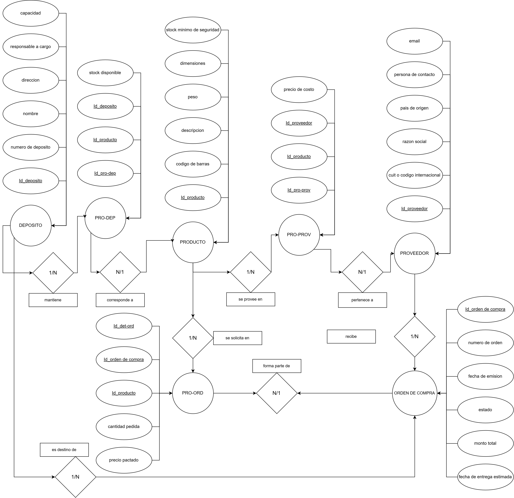

# BASE DE DATOS — Ejercicio 8: Gestión de Inventario, Proveedores y Cadena de Suministro

Trabajo práctico de Base de Datos (Universidad Champagnat). Este repositorio contiene todo el desarrollo del ejercicio 8: modelo entidad-relación, modelo relacional y normalización (1FN, 2FN y 3FN).

## Consigna


#### Contexto


Una empresa mayorista de distribución de productos electrónicos necesita optimizar su cadena de suministro mediante un sistema de gestión de inventarios que controle las existencias en almacenes, las órdenes de compra a proveedores internacionales y la trazabilidad de los lotes de mercadería.


#### Consigna


Construir el modelo entidad-relación para la cadena de suministro cumpliendo con las siguientes pautas:

La empresa opera en múltiples depósitos (almacenes), identificados por un número de depósito, nombre, dirección y responsable a cargo.

El catálogo de productos de la empresa incluye artículos identificados por su código de barras, descripción, peso, dimensiones y stock mínimo de seguridad.

Un producto se almacena en los distintos depósitos. Se debe registrar con precisión la cantidad exacta de stock disponible de cada producto en cada depósito específico.

Los proveedores se identifican por su CUIT o código internacional, razón social, país de origen, persona de contacto y correo electrónico. Un producto puede ser provisto por uno o varios proveedores, y un proveedor puede suministrar múltiples productos (registrando el precio de costo del proveedor para cada producto).

La empresa emite órdenes de compra a los proveedores. Una orden de compra posee un número de orden, fecha de emisión, estado y depósito de destino. Cada orden de compra contiene uno o varios productos solicitados, especificando la cantidad pedida y el precio pactado.


#### Desarrollo requerido


Modelar la relación N:M entre Producto y Depósito, incorporando el atributo de stock específico por ubicación física.

Establecer la relación N:M entre Producto y Proveedor con su respectivo atributo de precio de costo.

Diseñar la estructura de Orden de Compra y su detalle de ítems solicitados al proveedor.

Analizar restricciones de integridad para asegurar que las recepciones de mercadería actualicen correctamente el stock del depósito correspondiente.

## Estructura del repositorio

```
BASE_DE_DATOS_Ejercicio_8/
├── README.md
├── modelo-er/
│   ├── ejercicio_8.drawio        # diagrama editable (draw.io)
│   └── ejercicio_8.png           # exportación del diagrama
├── modelo-relacional/
│   ├── ejercicio_8_MR.xlsx               # modelo relacional
│   └── ejercicio_8_con_datos.xlsx        # modelo relacional con datos de ejemplo
└── normalizacion/
    ├── ejercicio_8_1FN.xlsx
    ├── ejercicio_8_2FN.xlsx
    └── ejercicio_8_3FN.xlsx
```

## Modelo entidad-relación



Archivo editable: [`modelo-er/ejercicio_8.drawio`](modelo-er/ejercicio_8.drawio).

## Modelo relacional

Tablas del modelo relacional original, antes de normalizar (`(PK)` clave primaria, `(FK)` clave foránea, `(UNIQUE)` valor único):

- **DEPOSITO**: `id_deposito(PK)`, `numero de deposito(UNIQUE)`, `nombre`, `direccion`, `responsible a cargo`, `capacidad`
- **PRODUCTO**: `id_producto(PK)`, `codigo de barras(UNIQUE)`, `descripcion`, `peso`, `dimensiones`, `stock minimo de seguridad`
- **PROVEEDOR**: `Id_proveedor(PK)`, `cuit o codigo nacional(UNIQUE)`, `razon social`, `pais de origen`, `persona de contacto`, `email(UNIQUE)`
- **ORDEN DE COMPRA**: `Id_orden de compra(PK)`, `numero de orden(UNIQUE)`, `fecha de emision`, `estado`, `monto total`, `fecha de entrega estimada`, `Id_proveedor(FK,UNIQUE)`
- **PRO-DEP**: `Id_pro-dep(PK)`, `ID_producto(FK,PK)`, `Id_deposito(FK,PK)`, `stock disponible`
- **PRO-PROV**: `Id_pro-prov(PK)`, `Id_producto(FK,PK)`, `Id_proveedor(FK,PK)`, `precio de costo`
- **PRO-ORD**: `Id_pro-ord(PK)`, `Id_producto(FK,PK)`, `Id_orden de compra(FK,PK)`, `cantidad pedida`, `precio pactado`

Archivos: [`ejercicio_8_MR.xlsx`](modelo-relacional/ejercicio_8_MR.xlsx) y [`ejercicio_8_con_datos.xlsx`](modelo-relacional/ejercicio_8_con_datos.xlsx).

## Lógica relacional

Cada entidad se convierte en una tabla con su clave primaria. Las relaciones se representan así:

- **1:N / N:1**: la clave primaria del lado "uno" se copia como clave foránea (FK) en la tabla del lado "muchos".
- **1:1**: igual que 1:N, pero la FK lleva restricción UNIQUE.
- **N:M**: se crea una tabla intermedia cuyas FK forman una clave compuesta, junto con una clave propia que se identifica por esa combinación.

Relaciones del modelo final (3FN):

- `ORDEN DE COMPRA` → `PROVEEDOR`: **1:1** (FK `id_proveedor` con UNIQUE en `ORDEN DE COMPRA`).
- `PRODUCTO` ↔ `DEPOSITO`: relación **N:M**, resuelta con la tabla intermedia `PRO-DEP` (sus FK forman la clave compuesta única).
- `PRODUCTO` ↔ `PROVEEDOR`: relación **N:M**, resuelta con la tabla intermedia `PRO-PROV` (sus FK forman la clave compuesta única).
- `PRODUCTO` ↔ `ORDEN DE COMPRA`: relación **N:M**, resuelta con la tabla intermedia `PRO-ORD` (sus FK forman la clave compuesta única).

## Normalización

Los cambios se muestran etapa por etapa; cada etapa parte del resultado de la anterior.

### Primera forma normal (1FN)

- `DEPOSITO`: se quitan `direccion`
- `DEPOSITO`: se agregan `calle`, `numero`, `ciudad`
- `PRODUCTO`: se quitan `dimensiones`
- `PRODUCTO`: se agregan `largo`, `ancho`, `alto`
- `PROVEEDOR`: se quitan `cuit o codigo nacional`
- `PROVEEDOR`: se agregan `tipo de identificacion fiscal`, `numero de identificacion fiscal`

### Segunda forma normal (2FN)

Sin cambios respecto de la etapa anterior: el modelo ya cumplía esta forma normal.

### Tercera forma normal (3FN)

- `ORDEN DE COMPRA`: se quitan `monto total`

#### Modelo final en 3FN

- **DEPOSITO**: `id_deposito(PK)`, `numero de deposito(UNIQUE)`, `nombre`, `calle`, `numero`, `ciudad`, `responsible a cargo`, `capacidad`
- **PRODUCTO**: `id_producto(PK)`, `codigo de barras(UNIQUE)`, `descripcion`, `peso`, `largo (cm)`, `ancho (cm)`, `alto (cm)`, `stock minimo de seguridad`
- **PROVEEDOR**: `Id_proveedor(PK)`, `tipo de identificacion fiscal(UK1)`, `numero de identificacion fiscal(UK1)`, `razon social`, `pais de origen`, `persona de contacto`, `email(UNIQUE)`
- **ORDEN DE COMPRA**: `Id_orden de compra(PK)`, `numero de orden(UNIQUE)`, `fecha de emision`, `estado`, `fecha de entrega estimada`, `Id_proveedor(FK,UNIQUE)`
- **PRO-DEP**: `Id_pro-dep(PK)`, `ID_producto(FK,PK)`, `Id_deposito(FK,PK)`, `stock disponible`
- **PRO-PROV**: `Id_pro-prov(PK)`, `Id_producto(FK,PK)`, `Id_proveedor(FK,PK)`, `precio de costo`
- **PRO-ORD**: `Id_pro-ord(PK)`, `Id_producto(FK,PK)`, `Id_orden de compra(FK,PK)`, `cantidad pedida`, `precio pactado`

Archivos: [`ejercicio_8_1FN.xlsx`](normalizacion/ejercicio_8_1FN.xlsx), [`ejercicio_8_2FN.xlsx`](normalizacion/ejercicio_8_2FN.xlsx), [`ejercicio_8_3FN.xlsx`](normalizacion/ejercicio_8_3FN.xlsx).
